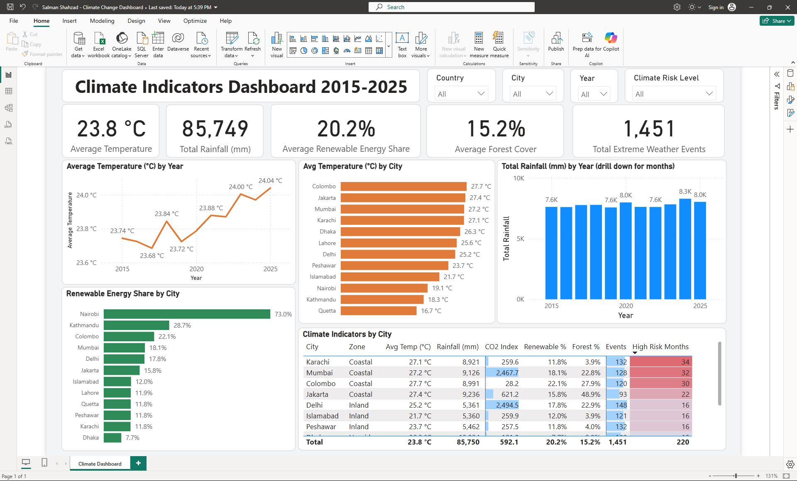
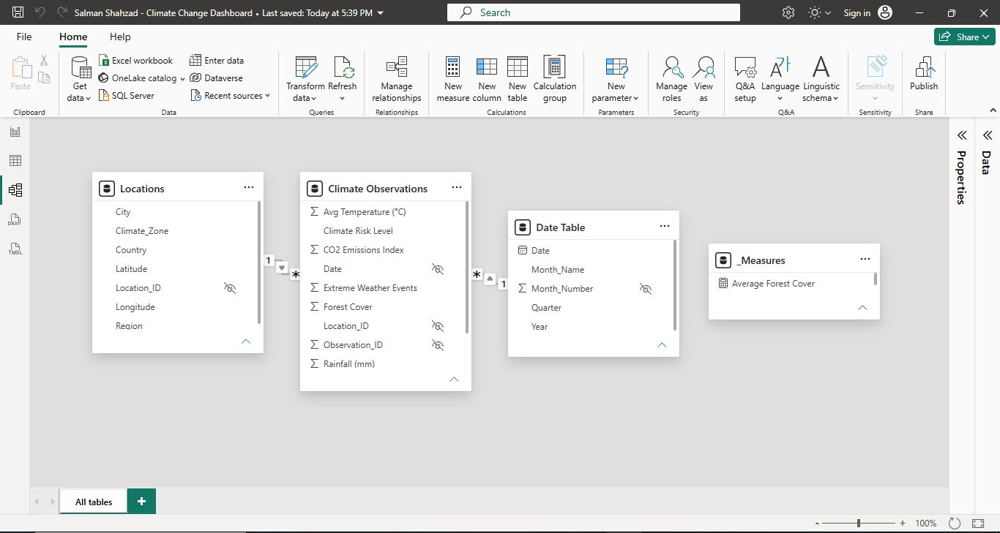

# Climate Indicators Dashboard 2015–2025 (Power BI)

An interactive Power BI dashboard analyzing monthly climate indicators across **12 cities in 7 countries** from **2015 to 2025**. The project covers the full workflow: data cleaning in Power Query, star-schema data modeling, DAX measures, and an interactive report with slicers and drill-down.



## Objective

Clean, model, analyze, and visualize climate indicators to answer questions such as:

- Is average temperature rising, falling, or stable from 2015 to 2025?
- Which cities are the hottest and coolest?
- Is there a seasonal rainfall pattern?
- Which locations have the highest and lowest renewable energy share?
- Which locations combine a high emissions index with frequent extreme weather events?

## Dataset

| Table | Type | Description |
|---|---|---|
| Climate Observations | Fact | 1,584 monthly records (after removing a duplicate) with temperature, rainfall, CO2 emissions index, renewable energy share, forest cover, sea-level rise, extreme weather events, and climate risk level |
| Locations | Dimension | 12 cities across Pakistan, India, Bangladesh, Nepal, Sri Lanka, Indonesia, and Kenya, with region and climate zone |
| Date Table | Dimension | Monthly calendar from January 2015 to December 2025 with year, month, and quarter |

## Tools & Skills

- **Power BI Desktop:** report design, slicers, drill-down, conditional formatting
- **Power Query:** data cleaning and transformation
- **DAX:** calculated measures stored in a dedicated `_Measures` table
- **Data Modeling:** star schema with one-to-many relationships

## Data Cleaning (Power Query)

- Removed one duplicate observation (1,585 → 1,584 rows)
- Kept missing Rainfall and Renewable Energy values as blanks rather than zeros, so they don't distort totals and averages
- Trimmed trailing spaces in city names (for example, "Peshawar ")
- Converted percentage columns to a 0–1 scale so they format correctly as percentages
- Set correct data types for dates, decimals, and whole numbers
- Renamed columns with clear labels and units, such as "Avg Temperature (°C)" and "Rainfall (mm)"

## Data Model



- `Locations[Location_ID]` → `Climate Observations[Location_ID]` (one-to-many)
- `Date Table[Date]` → `Climate Observations[Date]` (one-to-many)
- Single-direction filtering from dimension tables to the fact table
- Key and technical columns hidden from report view
- Month_Name sorted by Month_Number so months display in calendar order

## DAX Measures

```dax
Average Temperature = AVERAGE('Climate Observations'[Avg Temperature (°C)])
Total Rainfall = SUM('Climate Observations'[Rainfall (mm)])
CO2 Emissions Index = AVERAGE('Climate Observations'[CO2 Emissions Index])
Average Renewable Energy Share = AVERAGE('Climate Observations'[Renewable Energy Share])
Average Forest Cover = AVERAGE('Climate Observations'[Forest Cover])
Total Extreme Weather Events = SUM('Climate Observations'[Extreme Weather Events])
High Risk Months = CALCULATE(COUNTROWS('Climate Observations'), 'Climate Observations'[Climate Risk Level] = "High")
```

## Dashboard Features

- **KPI cards:** Average Temperature (23.8 °C), Total Rainfall (85,749 mm), Average Renewable Energy Share (20.2%), Average Forest Cover (15.2%), Total Extreme Weather Events (1,451)
- **Line chart:** Average temperature by year
- **Bar chart:** Average temperature by city
- **Column chart:** Total rainfall by year, with drill-down to months
- **Bar chart:** Renewable energy share by city
- **Matrix:** Climate indicators by city, with data bars and color scales highlighting CO2 index, extreme events, and high-risk months
- **Slicers:** Country, City, Year, and Climate Risk Level

## Key Insights

1. **Temperatures are rising gradually.** The average temperature increased from 23.74 °C in 2015 to 24.04 °C in 2025. The trend is upward overall, with small dips in some years such as 2016 and 2018.

2. **Coastal cities are the hottest.** Colombo (27.7 °C), Jakarta (27.4 °C), Mumbai (27.2 °C), and Karachi (27.1 °C) lead, while Quetta is the coolest at 16.7 °C. Karachi is about 10 °C warmer than Quetta despite both being in Pakistan, so climate zone matters more than country.

3. **The hottest months are the driest.** Rainfall peaks in winter, with January the wettest month, while July is the driest and among the hottest. Dhaka receives the most rainfall of any city and Quetta the least.

4. **Nairobi leads in renewable energy by a wide margin.** Nairobi averages 73.0%, far ahead of Kathmandu (28.7%), while Dhaka is lowest at 7.7%. Nairobi alone pulls the overall average up to 20.2%, so 9 of the 12 cities fall below it. The Pakistani cities sit around 12% renewable share and also have the lowest forest cover, at about 4%.

5. **Coastal cities have the most high-risk months.** Karachi (34), Mumbai (32), Colombo (30), and Jakarta (22) lead in high-risk months. Delhi and Mumbai have the highest CO2 emissions index (2,494.5 and 2,467.7) along with many extreme weather events (148 and 128). However, Colombo has a very low emissions index (28.2) yet still records 30 high-risk months, suggesting that temperature and coastal location align more closely with risk level than emissions do in this dataset.

## Repository Structure

| File | Description |
|---|---|
| `Climate_Change_Dashboard.pbix` | Power BI report file |
| `Climate_Change_PowerBI_Dataset_assignment.xlsx` | Source dataset |
| `dashboard.png` | Dashboard screenshot |
| `data_model.png` | Data model screenshot |
| `README.md` | Project documentation |

## How to Use

1. Download `Climate_Change_Dashboard.pbix`.
2. Open it in Power BI Desktop (free).
3. Use the slicers to filter by country, city, year, or climate risk level, and drill into the rainfall chart to see monthly patterns.

## Author

**Salman Shahzad**, Data Analyst · [LinkedIn](https://www.linkedin.com/in/salmanshahzad888)
